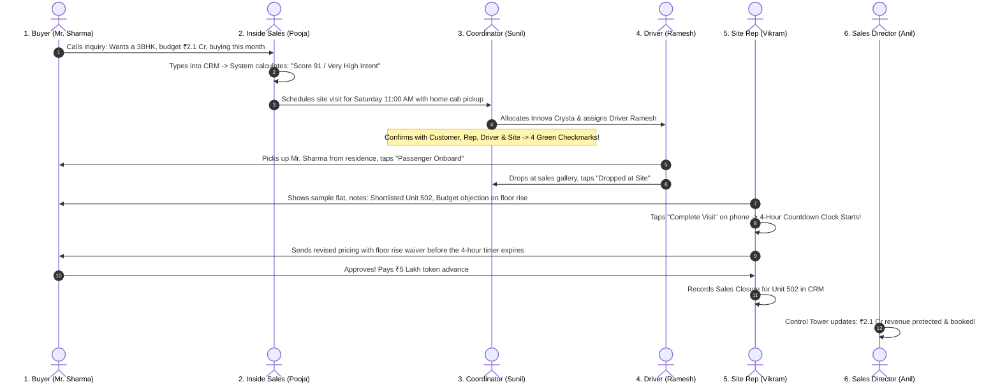

# 📘 Contech CRM (DARSHAN) — Complete Non-Technical Project Guide
## *The Plain-English Handbook to Every Module, Screen, and Feature*

---

> **Who is this guide for?**  
> This document is written specifically for **non-technical people** — real estate business owners, Managing Directors, Sales Heads, Marketing Managers, Site Visit Coordinators, and Sales Executives.  
> You don't need any programming or technical knowledge to understand this guide. Every screen, feature, and button is explained in simple everyday business language.

---

## 📑 Table of Contents

1. [What is Contech CRM & Why Does It Exist?](#1-what-is-contech-crm--why-does-it-exist)
2. [The Complete Customer Journey (How It All Connects)](#2-the-complete-customer-journey-how-it-all-connects)
3. [Module 1: Operations Control Tower (The Revenue Rescue Engine)](#3-module-1-operations-control-tower-the-revenue-rescue-engine)
4. [Module 2: High-Intent Radar & Smart Buyer Scoring](#4-module-2-high-intent-radar--smart-buyer-scoring)
5. [Module 3: Buyer 360° Dossier & Customer Management](#5-module-3-buyer-360-dossier--customer-management)
6. [Module 4: Site Visit Command Hub & 4-Way Confirmations](#6-module-4-site-visit-command-hub--4-way-confirmations)
7. [Module 5: In-Visit Discovery & Objection Engine](#7-module-5-in-visit-discovery--objection-engine)
8. [Module 6: Follow-Up SLA Reminders & 4-Hour Countdown Clock](#8-module-6-follow-up-sla-reminders--4-hour-countdown-clock)
9. [Module 7: Fleet Logistics & Driver Mobile Portal](#9-module-7-fleet-logistics--driver-mobile-portal)
10. [Module 8: Sales Closures & Unit Booking Ledger](#10-module-8-sales-closures--unit-booking-ledger)
11. [Module 9: Executive Dashboard & Revenue Analytics](#11-module-9-executive-dashboard--revenue-analytics)
12. [Module 10: Team Management & Role-Based Access Control](#12-module-10-team-management--role-based-access-control)
13. [Module 11: Projects, Audit History & System Settings](#13-module-11-projects-audit-history--system-settings)
14. [Real-World Day-in-the-Life Walkthrough](#14-real-world-day-in-the-life-walkthrough)
15. [Plain-English Glossary (Jargon Demystified)](#15-plain-english-glossary-jargon-demystified)

---

## 1. What is Contech CRM & Why Does It Exist?

### 💡 The Big Real Estate Problem: "The Silent 35% Leak"
Selling luxury apartments, villas, and commercial real estate is tough. Developers spend lakhs of rupees on digital ads, billboards, and property portals to get phone inquiries. 

Yet, studies and real-world sales audits reveal that **up to 35% of potential sales revenue is lost silently** — not because buyers disliked the project, but because of everyday operational hiccups:
* **The Forgotten Customer:** A serious buyer visits on a Sunday afternoon, loves the flat, but the sales rep forgets to call them back by Monday because their notes were lost in a paper diary or WhatsApp chat.
* **The No-Show Visit:** A customer books a site visit, but the company cab arrives late or nobody calls to confirm. The customer cancels, and the sales slot is wasted.
* **The Hidden Objection:** A customer hesitates because they disliked the kitchen layout or wanted a minor discount. The sales rep never writes it down, so management cannot step in with a customized payment plan.
* **Treating Everyone Equally:** Sales reps spend 80% of their energy on casual "window shoppers" while serious buyers with ₹2 Crore ready in bank accounts slip away to rival builders.

### 🛡️ The Solution: Contech CRM (DARSHAN)
**Contech CRM** acts as an **always-on digital guardian** for real estate developers. Think of it like an **Air Traffic Control Tower for real estate sales**:
* It ranks every incoming buyer from 1 to 100 so your team calls the hottest buyers first.
* It coordinates the buyer, sales rep, company chauffeur, and sales gallery so zero site visits get messed up.
* It sounds an alarm if a high-value customer has not been contacted in 48 hours.
* It enforces a strict **4-hour post-visit countdown clock** to send quotes while the customer's excitement is fresh.

---

## 2. The Complete Customer Journey (How It All Connects)

Here is how a buyer moves through the software from the first phone call to buying their dream home:

```
[1. New Inquiry Received] 
        │ (Recorded in CRM with budget & family needs)
        ▼
[2. Algorithmic Intent Scoring] 
        │ (Computer scores buyer: 88/100 -> "VERY HIGH INTENT")
        ▼
[3. Site Visit Scheduled] 
        │ (Date & time reserved, luxury cab requested)
        ▼
[4. 4-Way Confirmation Check] 
        │ (Customer ✓ | Sales Rep ✓ | Driver ✓ | Experience Gallery ✓)
        ▼
[5. Driver Pickup & Chauffeur Portal] 
        │ (Driver sees pickup address on phone, drives buyer to site)
        ▼
[6. In-Visit Walkthrough & Discovery] 
        │ (Rep shows flat, tags Unit 402, logs customer objections)
        ▼
[7. Automated 4-Hour Countdown Clock] 
        │ (System creates urgent task: "Send revised price plan before 4h")
        ▼
[8. Sales Closure & Unit Booking] 
        │ (Collect token advance, lock unit, celebrate booked home!)
```

If at any point a customer is neglected or a visit is cancelled, the **Control Tower** immediately flags it to the Sales Director to rescue the deal.

---

## 3. Module 1: Operations Control Tower (The Revenue Rescue Engine)

### 📌 In Plain English:
Think of the **Control Tower** as the "Check Engine Light" or the radar room of an aircraft carrier. Real estate directors don't have time to read hundreds of spreadsheets. They only want to know: **"Where is our money getting stuck right now, and who needs to fix it?"**

### 🎯 Why It Matters to the Business:
Prevents multi-crore deals from dying in silence. If an executive takes leave or drops the ball, the system catches it immediately.

### 👥 Who Uses It:
* **Managing Directors & CXOs:** To monitor total revenue at risk across all ongoing projects.
* **Sales Heads & Team Leads:** To catch delays and reassign deals in 1 click.

---

### 🖥️ Screens & Components in this Module:

#### 1. The Control Tower Radar Screen (`/control-tower`)
* **Component Name:** `ControlTowerViewComponent`
* **What you see on the screen:**
  * **System Health Score (e.g., 94%):** A big safety dial. 100% means zero delayed deals; below 80% means management intervention is needed.
  * **Neglected Serious Buyers:** A table of high-budget buyers who have not received a call or WhatsApp message in more than **48 hours**.
  * **Today's At-Risk Visits:** Site visits scheduled for today that are missing one or more confirmations (e.g., driver hasn't accepted or customer hasn't answered).
  * **Overdue Follow-Up Tasks:** Follow-up promises that missed their strict deadlines.
  * **Total Estimated Revenue at Risk:** A big red rupee figure (e.g., **₹4.85 Crore**) showing how much sales money is currently endangered by these delays.

* **Interactive Action: 1-Click Lead Rescue Button (`Rescue Deal`)**
  * When a manager sees a serious buyer sitting neglected under a sales rep, they don't need to argue. They click **"Reassign Lead"**, pick an active sales rep from a dropdown, and the deal is instantly transferred with all previous notes intact.

---

## 4. Module 2: High-Intent Radar & Smart Buyer Scoring

### 📌 In Plain English:
Not all customers who call your sales line are ready to buy. Some are students doing research, some have a ₹40 Lakh budget for a ₹2 Crore apartment, and some are wealthy families who want to move into a 3BHK within 15 days.  
The **High-Intent Radar** is like a metal detector for serious buyers. It analyzes every prospect and places them into 5 clear priority groups so your team calls the most urgent customers first.

### 🎯 The 4-Dimension Scoring Math (Explained Simply):
The system awards up to **100 points** across four real-world checks:

| Dimension | Maximum Points | What the System Looks At in Plain Words |
| :--- | :---: | :--- |
| **1. Profile Fit** | **20 Points** | Does this buyer match the project? (e.g., family size fits the 3BHK layout, workplace is near the project). |
| **2. Digital Intent** | **20 Points** | How interested are they online? Did they download the brochure? Did they review pricing? |
| **3. Budget Fit** | **25 Points** | Can they afford it? (e.g., stated budget matches or exceeds the flat price). |
| **4. Buying Urgency** | **35 Points** | How fast do they want to move? Buyers wanting a home within 30 days get maximum points. |

### 🏷️ The 5 Priority Bands:
* 🟢 **VERY HIGH INTENT (Score 86 - 100):** Ready to buy immediately. Needs a luxury cab visit booked within 24 hours.
* 🔵 **HIGH INTENT (Score 71 - 85):** Highly qualified. Needs customized 3D floor plans and payment schedules.
* 🟡 **QUALIFIED (Score 51 - 70):** Good prospect, but comparing with competitor projects. Needs active persuasion.
* 🟠 **EMERGING (Score 31 - 50):** Interested, but buying timeline is 6 months away. Keep in touch via newsletters.
* ⚪ **LOW (Score 0 - 30):** Casual inquiries or mismatched budgets. Low sales priority.

---

### 🖥️ Screens & Components in this Module:

#### 1. High-Intent Radar Grid (`/high-intent`)
* **Component Name:** `HighIntentRadarComponent`
* **What you see on the screen:**
  * Quick filter buttons to view buyers by their band (e.g., "Show me only Very High Intent").
  * Filter by sales executive (e.g., "Show me Vikram's hot leads").
  * Buyer cards showing their score badge (e.g., **"92/100"**), budget, and the AI's **"Next Best Action"** recommendation.
  * Direct one-click buttons to book a site visit or call the buyer directly.

---

## 5. Module 3: Buyer 360° Dossier & Customer Management

### 📌 In Plain English:
When a VIP customer checks into a luxury 5-star hotel, the manager knows their preferences before they even walk in. The **Buyer 360° Dossier** does the exact same thing for home buyers.  
Every customer gets a dedicated digital profile card (Dossier `#DAR-B101`) that stores their entire history in one place. No more asking the customer the same question twice!

---

### 🖥️ Screens & Components in this Module:

#### 1. All Prospects List (`/buyers`)
* **Component Name:** `BuyerListComponent`
* **What you see on the screen:**
  * Clean searchable directory of all customers.
  * Search bar to find customers instantly by Name, Phone, or Preferred Flat size.
  * Filter by lead stage (*New, Contacted, Qualified, Visit Scheduled, Negotiation, Booked*).
  * **"Bulk Import CSV"** button to import hundreds of leads from Facebook, Google Ads, or property portals without manual typing.
  * **"Export CSV"** button for quick reporting.

#### 2. New Buyer Intake Form (`/buyers/new`)
* **Component Name:** `BuyerFormComponent`
* **What you do here:**
  * Enter basic contact details: Full Name, Phone, Email.
  * Record home preferences: Preferred BHK (2BHK, 3BHK, Penthouse), Budget Range (e.g. ₹1.5 Cr to ₹2.2 Cr).
  * Record family details: Current residence, workplace location, family size (e.g. 4 members), financing readiness (*Pre-approved Loan, Self-funded, Awaiting Loan*).
  * **Smart Duplicate Warning:** If an agent tries to enter a phone number that already exists, the system warns them immediately to prevent two reps from fighting over the same customer!

#### 3. Complete Buyer 360° Dossier (`/buyers/:id`)
* **Component Name:** `BuyerDetailsComponent`
* **What you see on the screen:**
  * **The Header:** Big score badge (e.g., `SCORE 88/100 · VERY HIGH INTENT`), lead status pill, and assigned sales rep name.
  * **The 4-Dimension Visual Meters:** 4 color-coded progress bars showing exactly where the buyer scored high and where they scored low.
  * **Customer 360 Information Card:** Complete record of workplace, home location, financing readiness, and family requirements.
  * **AI Recommendation Box:** Clear instructions telling the sales rep what to do next (e.g., *"Urgent: Schedule site visit with luxury cab pickup within 24 hours"*).
  * **Sales Closures & Bookings Section:** If the customer bought a flat, the agreement value, token advance, and unit number are recorded here.
  * **Site Visit Timeline:** Every visit the customer ever made, including notes on which flat units they liked.
  * **Follow-up SLA Clock:** All pending tasks and countdown timers for this buyer.
  * **Scoring Audit History:** A timestamped diary showing how the buyer's score changed over time and which event caused it.

---

## 6. Module 4: Site Visit Command Hub & 4-Way Confirmations

### 📌 In Plain English:
The site visit is the most crucial moment in real estate. Over 80% of property purchase decisions happen after a customer physically visits the sample apartment.  
However, site visits often fail because of logistics confusion: the driver arrives at the wrong gate, the sales rep is tied up with another client, or the customer forgets.  
The **Site Visit Command Hub** eliminates this chaos with an airtight **4-Way Confirmation Check**.

### 🛡️ The 4-Way Confirmation System (How It Works):
Before a company car is dispatched or a time slot is used, the system checks **4 green checkmarks**:
1. 🟢 **Customer Confirmed:** Did the buyer answer their phone and confirm they are ready?
2. 🟢 **Sales Rep Confirmed:** Is a dedicated sales executive waiting on-site to greet them?
3. 🟢 **Driver Confirmed:** Has the company driver accepted the trip and inspected the vehicle?
4. 🟢 **Site Gallery Confirmed:** Is there open space in the experience centre, or is it overcrowded?

> **⚠️ The Safety Rule:** If any of these 4 checkmarks is missing 2 hours before the visit, the visit turns bright orange (**"AT RISK"**), alerting coordinators to fix the problem before a car is wasted.

---

### 🖥️ Screens & Components in this Module:

#### 1. Site Visit Command Hub (`/visits`)
* **Component Name:** `VisitListComponent`
* **What you see on the screen:**
  * A live board showing all visits organized by date and time slot (*10:00 AM, 12:00 PM, 2:30 PM, 4:30 PM*).
  * Buyer name, phone number, and selected project.
  * Assigned sales rep and assigned company cab number.
  * **Interactive 4-Way Confirmation Buttons:** 4 clickable pills (`Customer`, `Rep`, `Driver`, `Site`). When someone confirms, the coordinator clicks the pill and it turns green with a checkmark!
  * **Status Pills:** *Scheduled, In Progress, Completed, Cancelled, or No-Show*.

#### 2. Booking a Site Visit (`/visits/book`)
* **Component Name:** `VisitBookingComponent`
* **What you do here:**
  * Select the buyer and the project.
  * Pick an available date and time slot.
  * **Slot Overcrowding Protection:** If the 11:00 AM slot already has 4 visits booked (the gallery's maximum capacity), the system blocks the slot to prevent a crowded, poor customer experience and suggests the 1:00 PM slot instead.
  * **Cab Logistics Request:** Check *"Cab Required"*, enter the buyer's home address, and choose a vehicle from the company fleet (e.g., *Innova Crysta - MH 12 AB 1234*).

#### 3. Handling Cancellations & No-Shows (Automatic Recovery)
* If a customer calls and cancels: Click **"Cancel Visit"**, record the reason (e.g., *Family emergency*). The system automatically schedules a **2-hour recovery reminder** so the sales team can re-book them next week.
* If a customer simply doesn't show up: Click **"Mark as No-Show"**. The system immediately triggers an **urgent 30-minute recovery task** to call the customer and find out what happened.

---

## 7. Module 5: In-Visit Discovery & Objection Engine

### 📌 In Plain English:
When an agent walks a customer through a model flat, the customer talks constantly: *"I love the master bedroom view, but I hate the tile color in the guest bathroom,"* or *"My mother needs a Vaastu-compliant northeast kitchen,"* or *"The price is 10 lakhs higher than my budget."*  
In traditional companies, these gold nuggets of information are forgotten by the time the agent gets back to their desk.  
The **In-Visit Discovery Screen** is designed to be used on a smartphone or tablet **right during the walkthrough** to lock down this intelligence in seconds.

---

### 🖥️ Screens & Components in this Module:

#### 1. In-Visit Discovery & Walkthrough Tool (`/visits/discovery/:id`)
* **Component Name:** `VisitDiscoveryComponent`
* **What the Sales Rep fills in during or right after the visit:**
  * **Shortlisted Units:** Type in the exact flats the customer liked (e.g., *"Tower B - Unit 402, 3BHK East Facing"*).
  * **Customer Sentiment:** Choose between *Positive, Neutral, or Hesitant*.
  * **Main Objection Category:** Dropdown with real-world categories:
    * 💰 *Price / Budget Concern*
    * 📐 *Layout / Floor Plan Dislike*
    * 🧭 *Vaastu Compliance Issue*
    * 🏗️ *Construction Timeline Delay*
    * 🏊 *Amenities or Parking Issue*
  * **Objection Severity:** *Low, Medium, or High*.
  * **Rep's Field Notes:** Exact words spoken by the buyer.
  * **Recommended Sales Strategy:** What will it take to close this customer? (e.g., *"Offer a 10:90 milestone payment plan before 5:00 PM today"*).
  * **Next Follow-up Task:** The rep writes what document they promised to send.
* **The Magic Trigger:** The moment the rep clicks **"Save Discovery & Complete Visit"**, the system automatically changes the visit status to *Completed* and **starts the 4-Hour Countdown Clock**!

---

## 8. Module 6: Follow-Up SLA Reminders & 4-Hour Countdown Clock

### 📌 In Plain English:
In real estate sales, **speed is everything**. If a buyer visits a property on Sunday at 12:00 PM, their excitement is at 100%. If they don't receive a price sheet, bank loan options, or revised floor plans by Sunday evening, their excitement drops to 50%, and by Tuesday they are visiting your competitor.  
This module is the **policeman of the sales team**. It ensures that every promise made to a buyer has a strict countdown timer attached to it.

---

### 🖥️ Screens & Components in this Module:

#### 1. Follow-up SLA Reminders Dashboard (`/tasks`)
* **Component Name:** `TaskListComponent`
* **What you see on the screen:**
  * A prioritized to-do list of every single customer promise.
  * **Live Countdown Timers:**
    * ⏳ `3.2h Remaining` (Green/Amber tag ticking down in real time).
    * 🚨 `OVERDUE SLA` (Bright flashing red tag if the deadline passed).
  * **Priority Badges:** *Critical, Urgent, High, or Normal*.
  * Context showing the buyer's name, preferred flat size, and budget.
  * **1-Click "Complete Task" Button:** When the sales rep sends the document or finishes the phone call, they click **"Mark Done"**. The timer stops, the task is archived in the buyer's dossier, and leadership knows the job was done on time.

---

## 9. Module 7: Fleet Logistics & Driver Mobile Portal

### 📌 In Plain English:
High-value buyers expect a luxury, hassle-free experience. Offering a company chauffeur to pick them up from their home or office dramatically increases the chances that they will attend the site visit.  
However, regular CRM software is too complicated for drivers, and companies must never show confidential customer budgets or financial records to third-party drivers.  
This module provides a **dedicated, ultra-simple mobile screen** specifically designed for drivers on their smartphones.

---

### 🖥️ Screens & Components in this Module:

#### 1. Driver Mobile Portal: "My Daily Trips" (`/my-trips`)
* **Component Name:** `DriverTripsComponent`
* **What the driver sees on their mobile phone:**
  * Clean, high-contrast, large-button design that is easy to read while in a car.
  * Pickup time (e.g., *Today, 10:30 AM*).
  * Assigned vehicle name (e.g., *Innova Crysta - MH 12 AB 1234*).
  * Passenger Name and Pickup Address.
  * **1-Touch Phone Call Button:** The driver taps the phone button to dial the customer immediately without memorizing numbers.
  * **One-Touch Journey Progression Buttons:**
    * Step 1: Tap `[ Started Journey ]`
    * Step 2: Tap `[ Arrived at Customer House ]`
    * Step 3: Tap `[ Passenger Onboard ]`
    * Step 4: Tap `[ Dropped at Sales Gallery ]`
* **Data Security Guarantee:** The driver **never** sees the buyer's budget, occupation, negotiation status, or any company sales numbers.

#### 2. Fleet & Vehicle Master (`Vehicle` Controller)
* Coordinates company cars, tracks driver assignments, and prevents double-booking the same car for two simultaneous trips.

---

## 10. Module 8: Sales Closures & Unit Booking Ledger

### 📌 In Plain English:
This is the celebration screen! When all the hard work pays off and a customer agrees to buy a home, the sales team records the formal transaction here.

---

### 🖥️ Screens & Components in this Module:

#### 1. Sales Closure Record Modal (Inside Buyer Dossier)
* **What you record when a sale is closed:**
  * **Project Name:** (e.g., *Darshan Greens Phase 1*).
  * **Unit Number Allocated:** (e.g., *Tower A - Flat 804*).
  * **Unit Configuration:** (e.g., *3 BHK Luxury + Servant Room*).
  * **Agreement Sale Value:** (e.g., *₹1.95 Crore*).
  * **Token Advance Collected:** (e.g., *₹5.00 Lakhs*).
  * **Booking Date & Special Notes:** (e.g., *Includes covered car parking slot #14*).
* **What happens automatically behind the scenes:**
  * The customer's status is permanently updated to **"BOOKED"**.
  * The buyer is removed from all pending leakage alarms.
  * The booking reference number (e.g., `#BK-2026-0042`) is generated and locked into the company's financial ledger.

---

## 11. Module 9: Executive Dashboard & Revenue Analytics

### 📌 In Plain English:
The **Executive Dashboard** is the command bridge for owners and directors. It answers the question: *"How healthy is our sales business this month, and what is our sales pipeline worth?"*

---

### 🖥️ Screens & Components in this Module:

#### 1. Executive Operations Overview (`/dashboard`)
* **Component Name:** `DashboardOverviewComponent`
* **Key Numbers Highlighted:**
  * 💰 **Active Pipeline Value:** (e.g., *₹50.51 Crore*) — Total value of all prospective deals currently in discussion.
  * ⚠️ **Revenue at Risk:** (e.g., *₹60.97 Crore*) — Potential sales endangered by neglected callbacks or missed deadlines.
  * 🎯 **High-Intent Prospects:** Count of active hot buyers in the system.
  * 🚗 **Today's Scheduled Visits:** Count of buyers visiting your projects today.
  * ⏱️ **Active SLA Breaches:** Count of follow-up tasks currently past their due time.
  * **Top Revenue Leakage Table:** Live list of the top 5 largest deals currently stuck, showing the customer name, budget at risk, and exact reason.

#### 2. Deep Revenue Analytics & Conversion Funnel (`/analytics`)
* **Component Name:** `RevenueAnalyticsComponent`
* **What you see on the screen:**
  * **The 9-Stage Conversion Funnel:** A visual chart showing how leads progress:
    $$\text{New} \longrightarrow \text{Contacted} \longrightarrow \text{Qualified} \longrightarrow \text{High Intent} \longrightarrow \text{Visit Scheduled} \longrightarrow \text{Visit Done} \longrightarrow \text{Negotiation} \longrightarrow \text{Booking Intent} \longrightarrow \text{Booked}$$
    * Shows the exact **drop-off rate percentage** at every stage so marketing heads know where deals are falling out of the bucket.
  * **Lead Source Performance:** Compares which advertising channels produce the highest paying customers (*Google Ads vs Meta Instagram vs Property Portals vs SimpliQualify Direct*).
  * **Team SLA Compliance Rate:** Percentage score of how reliably sales reps meet their 4-hour countdown deadlines.

---

## 12. Module 10: Team Management & Role-Based Access Control

### 📌 In Plain English:
A real estate company has many different people: directors, sales reps, receptionists, drivers, and external channel partners.  
You would never give your company checkbook to a cab driver, and you don't want junior telecallers deleting customer records.  
This module acts as the **digital security guard**, ensuring that each person only sees what they need to do their job, and nothing more.

---

### 🖥️ Screens & Components in this Module:

#### 1. Team Directory (`/team` & `/users`)
* **Component Name:** `UserListComponent`
* **What you can do here:**
  * Add new employees with their Name, Phone, Email, and Department.
  * Assign reporting managers (e.g., *Rahul reports to Sales Manager Amit*).
  * Assign monthly sales targets in Lacs/Crores.
  * **Safe Employee Offboarding (Deactivation Safeguard):** When an employee leaves the company, an admin can click **Deactivate**. The system refuses to delete their historical data, and prompts the manager to reassign all their open buyers and tasks to another active rep so **no lead is ever abandoned**.

#### 2. Enterprise Access Control & Permission Matrix (`/access-control`)
* **Component Name:** `AccessControlViewComponent`
* **What you can do here:**
  * **12 Predefined Job Roles:**
    1. *Super Admin / Org Admin* (Complete company authority)
    2. *Managing Director / CXO* (Full business visibility & reports)
    3. *Sales Head / VP* (Total team & pipeline management)
    4. *Marketing Head* (Lead source analysis & campaign quality)
    5. *Sales Manager* (Daily approvals, visit schedules, task monitoring)
    6. *Account Executive / Site Rep* (Site walkthroughs & buyer negotiation)
    7. *Inside Sales / Telecaller* (Lead qualification & visit booking)
    8. *Site Visit Coordinator* (Cab dispatch & gallery slot management)
    9. *Driver / Chauffeur* (Pickup coordinates & trip status buttons only)
    10. *Executive Viewer* (Read-only observer for investors or auditors)
  * **Granular Permission Checkboxes:** Turn on/off permissions per module (*Can View, Can Create, Can Edit, Can Delete, Can Export, Can Reassign, Can Approve*).
  * **"Specific Person" Overrides:** Want to allow one trusted senior sales executive to view director-level analytics without promoting everyone else in their role? You can toggle permissions for that specific individual in 1 click!
  * **Clone Permissions:** Copy permissions from one role to another instantly.

---

## 13. Module 11: Projects, Audit History & System Settings

### 📌 In Plain English:
The administrative backbone that keeps the software configured to your company's exact rules, keeps an unalterable history of every action, and manages property details.

---

### 🖥️ Screens & Components in this Module:

#### 1. Projects Master (`/projects`)
* **Component Name:** `ProjectsComponent`
* **What you manage here:**
  * Project names (e.g., *Darshan Heights, Darshan Serene*).
  * Project locations, Google map coordinates, and experience centre capacity.
  * Available unit types (*2BHK, 3BHK, 4BHK Duplex, Penthouse*).
  * Base pricing and inventory counts.

#### 2. System Settings (`/settings`)
* **Component Name:** `SettingsViewComponent`
* **What you manage here:**
  * Working hours for site visits (e.g., *09:30 AM to 06:30 PM*).
  * Maximum site visits allowed per hour (e.g., *Max 4 visits per slot* to avoid crowds).
  * SLA time limits (e.g., *4 hours for post-visit follow-up; 48 hours for neglected lead alarm*).

#### 3. Audit Logs & Activity History (`/audit-logs`)
* **Component Name:** `AuditLogsComponent`
* **What you see here:**
  * An unchangeable, permanent black-box recording of every major change made in the software:
    * *Who made the change?*
    * *What customer or deal was changed?*
    * *What was the old value and what is the new value?*
    * *Exact date and second.*
  * Total accountability — no one can delete a customer or reassign a lead without a permanent record.

---

## 14. Real-World Day-in-the-Life Walkthrough

To see how everything fits together in practice, here is a story of a single Saturday at **Darshan Greens**:



---

## 15. Plain-English Glossary (Jargon Demystified)

| Term | What It Means in Simple English |
| :--- | :--- |
| **SLA (Service Level Agreement)** | A strict deadline for doing a job (e.g., *"Call the customer back within 4 hours"*). |
| **SLA Breach** | Missing that deadline (the timer turns red and alerts the boss). |
| **Revenue at Risk** | The total value of deals currently in danger of being lost due to forgotten callbacks or missed visits. |
| **4-Way Confirmation** | A 4-point safety check verifying the Customer, Sales Rep, Driver, and Site Gallery are all 100% ready before a visit starts. |
| **Buyer 360° Dossier** | A complete single-page digital folder containing everything about one customer (preferences, notes, visits, bookings). |
| **Intent Score** | A rating from 1 to 100 calculated by the computer to show how serious and ready a buyer is. |
| **Intent Band** | The priority category assigned to a buyer (*Very High, High, Qualified, Emerging, Low*). |
| **In-Visit Discovery** | Notes taken by a sales rep on their mobile phone while showing a customer around the model flat. |
| **Revenue Leakage** | Sales money that slips away because someone forgot to follow up, a cab broke down, or an objection was ignored. |
| **Drop-Off Rate** | The percentage of customers who lose interest between one sales step and the next. |
| **No-Show** | When an appointment is booked, but the customer does not turn up. |
| **Role-Based Access** | Giving team members access only to the parts of the software necessary for their specific job. |

---

### 🏁 Summary
**Contech CRM (DARSHAN)** transforms chaotic real estate sales operations into a smooth, disciplined, high-converting revenue machine. By automating follow-ups, guaranteeing cab logistics, scoring buyers honestly, and alerting leadership to bottlenecks in real time, it protects every rupee of developer marketing investment and ensures no serious home buyer is ever left behind.
